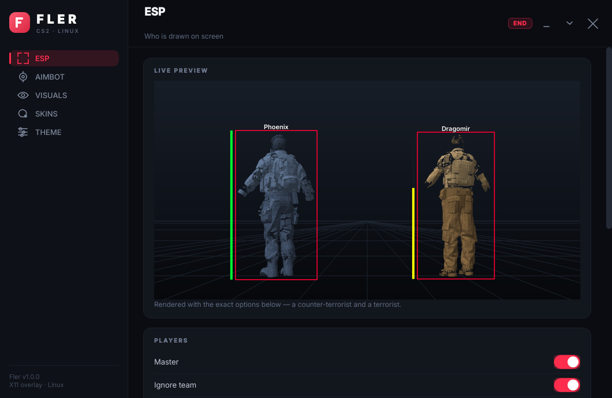
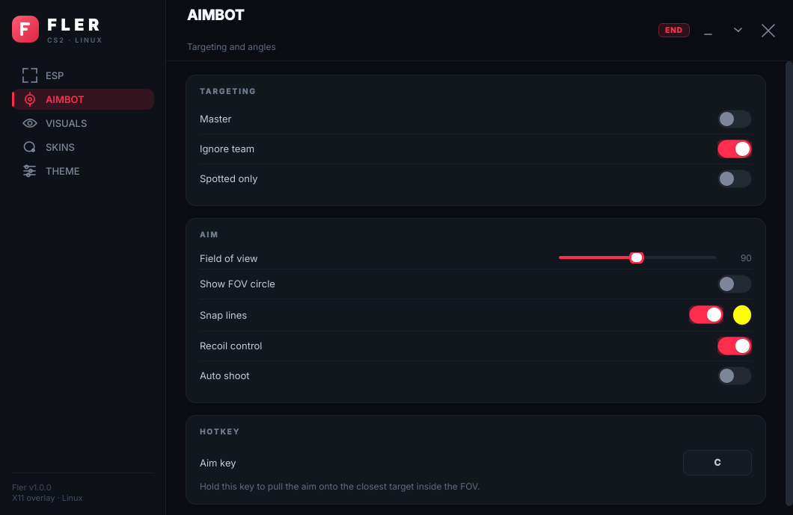
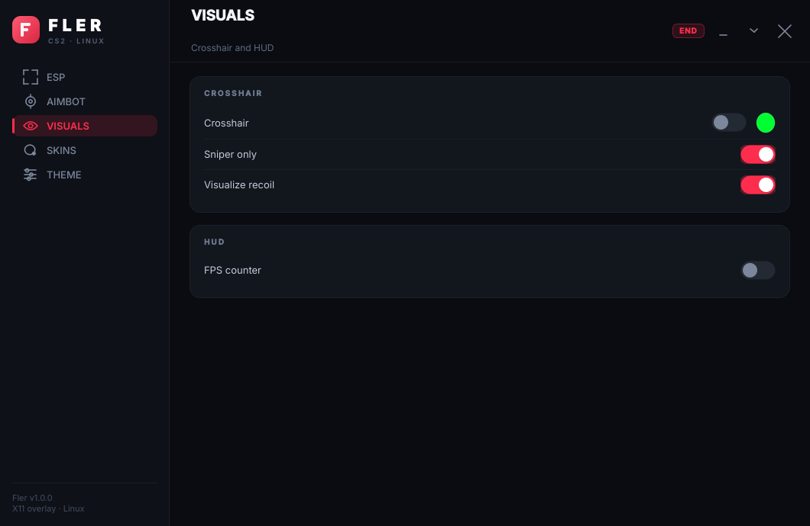
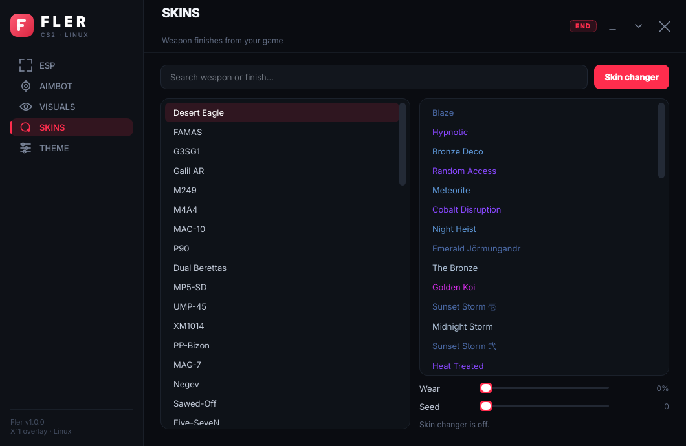
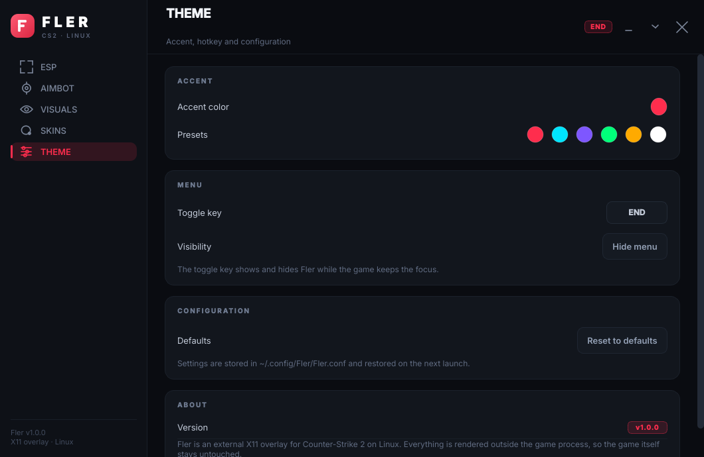

<div align="center">

# Fler

**External X11 overlay for Counter-Strike 2 on Linux.**

A fork of [Doctor-Coomer/CounterStrike2-Linux-Cheat](https://github.com/Doctor-Coomer/CounterStrike2-Linux-Cheat)
with a rebuilt, premium Qt menu — a live ESP preview with the real game agents,
a draggable frameless window, a live accent theme, and settings that survive
restarts.

</div>

## Menu

| Page | What it holds |
| --- | --- |
| **ESP** | Live preview with the real counter-terrorist and terrorist, master, team filter, spotted filter, box, health bar/text, name, weapon, skeleton, head dot, cat ears, snap lines — each with its own colour |
| **Aimbot** | Targeting filters, FOV slider, FOV circle, snap lines, recoil control, auto shoot, rebindable aim key |
| **Visuals** | Crosshair with colour, sniper-only crosshair, recoil visualisation, FPS counter |
| **Skins** | Every finish of every weapon from your own game, searchable, with rarity colours, wear and seed |
| **Theme** | Live accent colour with presets, menu hotkey, hide, reset to defaults, version info |







### The skin changer

The **Skins** page lists the real econ database — every paint kit the game ships,
per weapon, with the localised names and the rarity colours. It is extracted
from your own install:

```console
$ ./tools/fetch_skins.py
```

That writes `assets/skins.json`: the paint kits from `items_game.txt`, their
names from `csgo_english.txt`, and the per weapon lists recovered from the
econ preview image names in the VPK.

Turning the changer on writes the finish into the weapon you hold from the
outside: the fallback paint kit, seed and wear on the weapon entity, plus the
item attribute list when the item already carries one, and the item id is
invalidated so the client rebuilds it.

The schema offsets shift with every Counter-Strike update, so they are
calibrated against an offset that is known to work and every write is guarded
by a sanity check — a stale schema leaves the changer off instead of
corrupting the game. The status line at the bottom of the page says which
state it is in.

### The ESP preview

The preview is not a mock-up: it renders the actual CS2 agent meshes in a
software rasteriser and draws the overlay on top with the very options the live
cheat uses — box, health bar, health text, name, weapon, skeleton, head dot,
cat ears and snap lines, in your colours.

The meshes come from your own CS2 install (they are Valve assets, so they are
not committed here). Pull them once:

```console
$ ./tools/fetch_models.sh
```

The script finds the game, downloads the ValveResourceFormat CLI, extracts
`ctm_st6` and `tm_phoenix` from `pak01_dir.vpk` and writes `assets/ct.glb` and
`assets/t.glb`. Without them the preview falls back to drawn stand-ins and
everything else keeps working.

### Window handling

- **Drag** the header to move the window — it goes through the compositor, so it
  works on Wayland too.
- **Hide** the menu with the chevron in the header, with the tray icon, or with
  the toggle key (`End` by default, rebindable in the *Theme* page). The toggle
  key is grabbed on the X server, so it fires while the game holds the focus.

### What changed against the original menu

- **Frameless window** with rounded corners, a draggable header and a sidebar
  navigation rail instead of a `QTabWidget`.
- **Custom widgets**: animated toggle switches, round colour swatches that open
  a styled picker, a single-key capture button for the aim hotkey, a keysym
  capture for the menu hotkey, and hand-drawn vector icons.
- **Live accent theme** — pick any colour and the whole menu repaints instantly;
  six presets ship in the box.
- **Persistence** — every option is written to `~/.config/Fler/Fler.conf` and
  restored on the next launch. `Reset to defaults` wipes it back to stock.
- **Qt lives in the main thread** — the original ran `QApplication` on a worker
  thread, which is unsupported; the overlay and game loops are the ones on
  workers now.

## Build

### Dependencies

Debian/Ubuntu:

```console
$ sudo apt install mesa-common-dev libx11-dev libxfixes-dev libxcomposite-dev gcc g++ make qt6-base-dev
```

Arch Linux:

```console
$ sudo pacman -S base-devel xorg-fonts-misc qt6-base
```

Fedora (only tested on Fedora 42):

```console
$ sudo dnf install g++ libX11-devel libXtst-devel libXcomposite-devel qt6-qtbase-devel
```

### Compile and run

```console
$ git clone https://github.com/abaudno925-create/Fler.git
$ cd Fler
$ make
$ sudo ./fler
```

`fler` needs root, because it reads the game's memory, and it expects `cs2` to be running.

To look at the menu without the game attached:

```console
$ FLER_GUI_ONLY=1 ./fler
```

## Features

- **ESP** — box, health bar, health text, name, weapon name, skeleton, head dot,
  cat ears, snap lines, team and spotted filters
- **Visuals** — crosshair, sniper crosshair, recoil visualisation, FPS counter
- **Aimbot** — FOV circle, recoil control, auto shoot, rebindable hotkey
- **Skins** — the full paint kit database of your own game, applied to the weapon in hand

## Compatibility

Fler strictly uses X11. The overlay is a transparent, unredirected X window composited over
the game, so a Wayland session works through XWayland as long as the compositor handles
double buffering.

Compositors such as Hyprland have no good XWayland support for double buffering and the
overlay will not render correctly there. A native Wayland backend would fix that.

## Credits

Original work: [Doctor-Coomer/CounterStrike2-Linux-Cheat](https://github.com/Doctor-Coomer/CounterStrike2-Linux-Cheat)
(itself derived from [yoshisaac/CounterStrike2-Linux-Cheat](https://github.com/yoshisaac/CounterStrike2-Linux-Cheat)).
Licensed under the GNU GPL v3 — see `LICENSE`.
